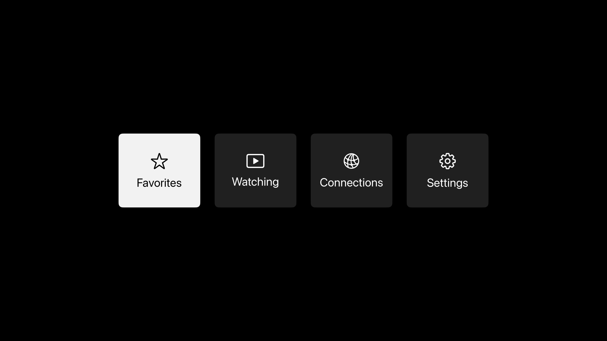
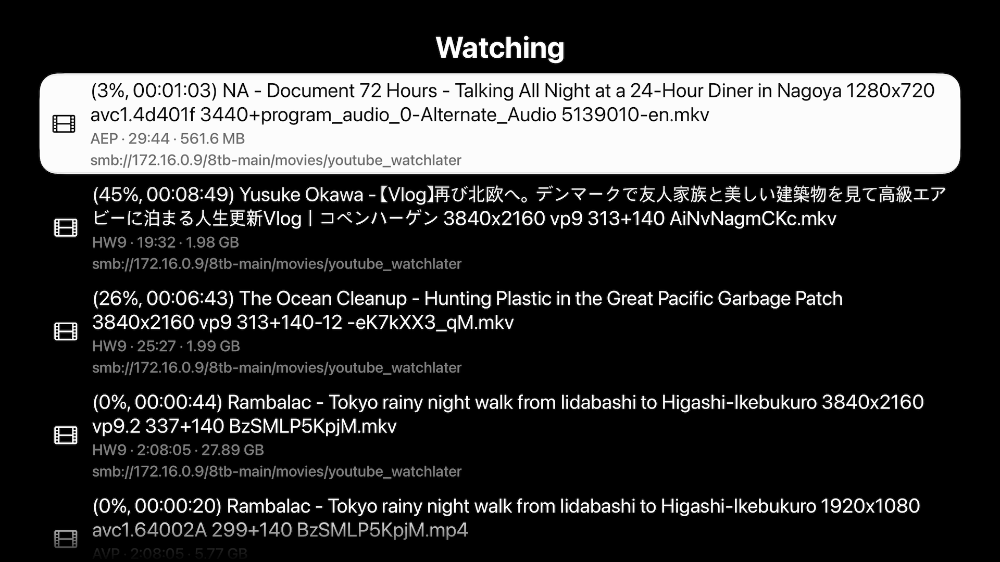

# BoraMin

Test Flight: [here](https://testflight.apple.com/join/9WQzbHVj)

bo-ra! (보라!) == Look! (Korean)  
Min = minimal

A native SMB and HTTP(S) video player for Apple TV, iPhone, and Mac. Stream from a NAS or other remote server, save favorite folders, and resume unfinished videos across devices using iCloud.

No metadata: this is not Plex or Infuse. It doesn't look up IMDB info or match files to shows. It shows full filenames and the actual contents of SMB/HTTP folders.

Hardware VP9 playback: for those of us with older Apple TVs (like 4K 2nd Gen (2021)), the CPU is not fast enough for playback of 4K 60fps HDR videos. Aside from YouTube (due to an entitlement), until a few months ago it was impossible for tvOS apps to use the hardware decoder. It is possible now and BoraMin supports this.

## Features

- **No metadata:** this is not Plex or Infuse. It doesn't look up IMDB info or match files to shows.
- **Connections:** save SMB shares/folders or HTTP(S) as connections. Connections open on demand and reconnect for browsing when needed.
- **Favorites:** save folder/share paths. Favorite selected folders for quick access.
- **iCloud sync:** synchronize saved connections, credentials, favorites, and playback positions of watching videos.
- **Watching:** resume watching videos you didn't have time to finish.
- **OLED mode (tvOS):** automatically dim screen when inactive for 10 seconds. Dimmable by 25%, 50%, 75%. Undims automatically on user action.
- **Speed test:** on any file, test download speed to ensure your connection is working well.

## Playback Engines

- **VP9 in MKV / MP4 / M4V / MOV / WebM:** the original hardware VideoToolbox decoder and separate video layer, with AVKit controls.
- **MP4 / M4V / MOV:** native AVPlayer playback
- **Other formats:** AetherEngine handles this; uses native AVPlayer when supported, otherwise its software video surface with app-written controls built from standard SwiftUI components.

## Build

| Platform | Minimum OS | Xcode scheme |
| --- | --- | --- |
| Apple TV | tvOS 26.2 | BoraMin tvOS |
| iPhone / iPad | iOS 26.0 | BoraMin iOS |
| Apple Silicon Mac | macOS Sequoia 15.0 | BoraMin macOS |

Requires Xcode, Python 3, `make`, and network access for the first build.

1. Build FFmpeg for your target with `python3 tools/build_ffmpeg.py --platform macos`. Substitute `ios`, `tvos`, or `tvos-simulator` as needed.
2. For signed builds, copy [the example config](Config/Identity.example.xcconfig) to `Config/Identity.local.xcconfig` and fill in your registered Apple Developer team and app identifiers. Reuse the existing identifiers when building for an existing installation.
3. Open `BoraMin.xcodeproj`, choose the scheme above, and build for a physical arm64 device, an Apple Silicon Mac, or an arm64 tvOS simulator. Keep signing enabled for the tvOS simulator so Xcode embeds its CloudKit entitlements.

See the [licences](Licences/README.md) and [dependency distribution requirements](vendor/DEPENDENCIES.md).

## Development notes

- [Agent guidance and project boundaries](AGENTS.md)
- [Playback logs and crash reports](docs/Diagnostics.md)
- [Subtitle regression fixtures and checks](docs/External-subtitles.md#local-regression-probe)
- [Device probes and investigations](Tests/README.md)

Connection and browsing errors translate SMB/POSIX codes, HTTP statuses, and URLSession network codes into guidance, with numeric codes retained for diagnostics. Missing locations and access failures do not imply a specific server-side cause. Failed navigation keeps the previous directory visible.
